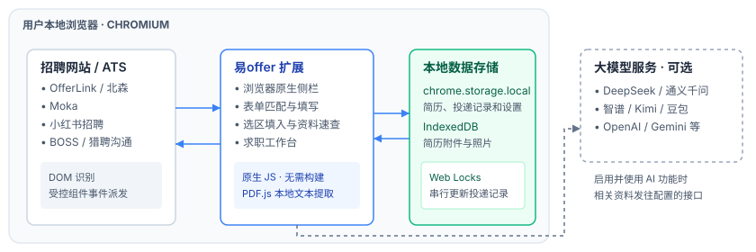

# 易offer / easyoffer

**网申填写助手 · Job application autofill assistant**

易offer 是面向校招和社招网申的浏览器扩展，支持多简历管理、表单填写和投递跟进。支持原生扩展侧栏的 Chrome 和 Edge 均可加载。

扩展基于 Manifest V3 和原生 JavaScript，可直接加载本仓库中的运行文件。

## 界面

扩展内部工作区默认打开「我的简历」。顶部可切换产品功能、我的简历、求职工作台、帮助中心和设置。

## 能做什么

- **一键填入**。按标签、占位提示和表单语义匹配姓名、联系方式、教育、实习和项目等字段。扩展调用浏览器原生的值设置方法并派发 `input`、`change` 等事件，适配部分受控表单。
- **增量填入**会保留已有内容，默认补现有行。需要添加简历中的剩余条目时，可勾选「增量填入时也补建条目」。
- **AI 助填**。先用本地规则填写基础字段，再按配置让模型匹配剩余字段或生成开放题答案。提交前请核对填入的内容。
- **选区填入**。框选网页上的经历区域，再指定一条简历经历填入。
- **浏览器侧栏**。点工具栏的易offer图标，在网页旁边切换简历、发起填入、查看待核对字段。侧栏宽度由浏览器控制。
- **资料速查**按简历条目分组。点选网页字段后可直接填入单项，也可预览并确认同一行的多项资料。停用模块、浏览器内置页及其他扩展页面可复制后粘贴。
- **多条填写**先匹配网页已有行，再补空行，最后逐条新增并核对控件结果。遇到行身份不明确或需要网站确认时，剩余条目会列为待处理。
- 填写时可在侧栏暂停、继续或取消。OfferLink 的日期、下拉和地区控件按页面选项填写并回读，资料缺值与控件未确认会分别显示。
- 新建简历时可创建空白资料，或选择一份已有简历复制。副本的经历和附件可独立编辑。
- 简历工作台支持多条目卡片、详细字段和上下排序。「IT 技能」提供分组搜索，可选技能和掌握程度，也可输入自定义技能。旧技能标签会转为独立记录。
- 家庭成员在同一张卡片编辑。职业、工作单位和职务分别保存，供网申表单按字段填写。
- 「外语能力」按语种或考试保存为独立卡片，可快捷新增四级、六级、雅思和托福。旧成绩和小语种备注自动合入卡片。同一考试有多条不同成绩时，可指定一条用于只有一个成绩框的网申。
- 家庭现居地址使用一个字段录入，旧简历的省、市、区县和详细地址会合并显示。
- OfferLink 新增经历后会展开收起的卡片再填写。简历日期用月历选择，可以选具体日期或仅保存年月。需要完整日期的网页控件会提示补充具体日，可从「日期待完善」定位回简历。
- 「模块管理」随简历保存启用状态。关闭模块后仍可备份原始资料，自动填写和新增经历会跳过该模块。
- 求职工作台默认显示投递表格，可以切换看板和仪表盘。「面试中」可细分待一面、待二面和待终面。侧栏顶部和填入结果都提供「记录此岗位」。岗位草稿默认为「已收藏」，核对后由用户保存。工作台可预览导入 CSV，历史待核实记录独立标记。
- **秋招字段**：政治面貌、民族、籍贯、生源地、入党 / 入团时间、婚姻状况、家庭成员、院校层次、结构化证书、论文、专利、开源成果、常用问答、个人声明
- **可选 AI**。从 PDF、DOCX 或图片提取结构化简历资料，也可生成 HR 打招呼语。
- **附件**：简历源文件存在本机 IndexedDB，可作网申代传附件
- **备份**可下载完整 JSON，或选择简历和其他资料导出。恢复前会预览同 ID 冲突，已有简历默认跳过。选择独立本地目录并授权后，保存资料会自动留下快照。下载默认排除 API Key，自动快照始终排除 API Key。

## 选区填入与快捷键

在侧栏点击「选区填入」，然后回到网页操作。

| 操作 | 效果 |
| --- | --- |
| 按住**左键拖框** | 圈选一段区域，把选中的一条经历批量填入框内字段 |
| **右键** | 取消当前拖出的框 |
| **Esc** | 退出选区模式 |
| 按住 **Ctrl / Command** 拖框 | 一次拖出多个框，多段内容同时填入 |

框选后，右侧会显示“选择填写内容”面板。选择分类和具体经历，再点「立即填入」；已有值默认跳过。点击「完成框选」可结束 Ctrl / Command 多区域选择，重复区域中的字段会去重。

## 安装

1. 有仓库访问权限的用户可以点 **Code → Download ZIP** 并解压，或运行 `git clone https://github.com/yan315598-design/easyoffer.git`。
2. 在地址栏打开扩展管理页。Chrome 使用 `chrome://extensions/`，Edge 使用 `edge://extensions/`。
3. 启用开发者模式。Chrome 点击「加载已解压的扩展程序」，Edge 点击「加载解压缩的扩展」。
4. 选择解压或克隆后包含 `manifest.json` 的 `job-autofill-assistant/` 文件夹。
5. 将易offer固定到工具栏。在网申页面点击图标打开侧栏。

更新后在扩展管理页重新加载扩展，再刷新招聘网页。

## 使用

1. 点扩展图标 →「配置资料与简历」，手工填写或用 AI 解析简历
2. 打开企业校招 / 北森 / 莫招 / 大易 / Moka 等网申页
3. 在侧栏点「一键填入」。开放题可以用「AI 助填」，整块空白可以用「选区填入」，单个字段可以用「资料速查」
4. 核对并在招聘网站提交。想跟进这个岗位时，点「记录此岗位」，确认阶段后保存到工作台

AI 助填和 AI 简历解析可在「设置」中配置。支持 DeepSeek、通义千问、智谱 GLM、Kimi、豆包、硅基流动、OpenAI 和 Gemini。

## 网站适配

| 场景 | 当前适配 |
| --- | --- |
| OfferLink 简历页 | 处理日期、下拉选项和地区级联，按经历卡片匹配资料。 |
| 北森（Phoenix） | 适配特定表单结构、下拉框和日期控件。 |
| Moka | 适配部分下拉框、日期控件和动态经历卡片。 |
| 小红书招聘 | 适配 `job.xiaohongshu.com` 上可识别的部分日期和选择控件。 |
| 多益网络校招 | 适配 Tec Design 单选、下拉和地区级联，可按网页已有姓名或亲属关系匹配家庭关系行。 |
| 其他网申页面 | 使用通用表单规则。复杂自定义控件可能需要用「资料速查」复制后手工填写。 |

HR 打招呼功能可向识别到的聊天输入框写入问候语，消息由你核对并发送。验证码、笔试以及申请提交由你在网站完成。

## 权限与隐私

- 扩展申请网站访问权限，用于识别网申表单及在你发起填写时操作网页控件。
- 简历资料、投递记录和设置保存在当前浏览器的 `chrome.storage.local`，附件存放在 IndexedDB。项目没有自建后端。
- 使用 AI 解析简历时，模型接口会收到提取的简历文字、原始文件或转换后的页面图片，具体取决于文件类型和模型配置。PDF.js 在浏览器内提取文字或渲染页面，结构化解析由所配置的模型处理。
- 使用 AI 助填时，待填字段或题目及相关简历资料会发往所配置的模型接口。连接测试和获取模型列表也会访问模型服务。
- API Key 保存在本地扩展设置中，用于请求鉴权。完整 JSON 备份默认排除密钥，勾选「在备份中包含 API Key」后才会写入备份。

## 项目结构

以下路径位于 `job-autofill-assistant/`。

| 路径 | 职责 |
| --- | --- |
| `manifest.json` | 扩展入口、权限及脚本注册 |
| `options/` | 简历编辑、求职工作台、帮助中心与设置 |
| `popup/` | 浏览器侧栏界面和交互 |
| `scripts/background.js` | 扩展 Service Worker 和消息处理 |
| `scripts/profile-schema.js` | 简历字段及模块定义 |
| `scripts/resume-parser.js` | 简历文本提取与 AI 解析 |
| `scripts/storage.js`、`scripts/attachments.js` | 浏览器存储、附件和数据备份 |
| `scripts/content/` | 字段识别、控件适配、填写及选区交互 |
| `vendor/pdfjs/` | 随扩展打包的 PDF.js |

更多实现细节见[扩展架构](job-autofill-assistant/ARCHITECTURE.md)。

## 许可证与第三方组件

项目级许可证待定。随仓库分发的第三方组件附带各自的许可证。

- [PDF.js](job-autofill-assistant/vendor/pdfjs/LICENSE)
- [PDF 字符映射](job-autofill-assistant/vendor/pdfjs/cmaps/LICENSE)
- [界面字体](job-autofill-assistant/fonts/LICENSE.txt)
